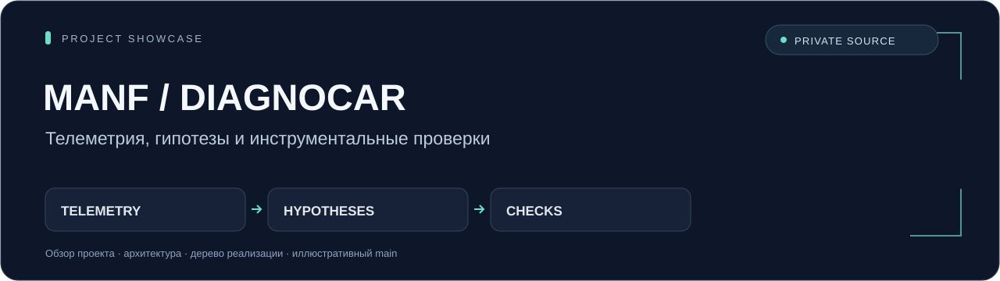
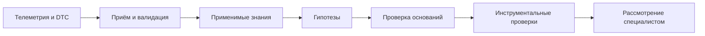

# MANF-DiagnoCAR

### От телеметрии к проверяемому диагностическому заключению



**Портфолио проекта МАНФ:** система поддержки автомобильной диагностики, в которой входные данные, предметные знания, гипотезы и инструментальные проверки образуют прослеживаемый процесс.

`Python` · `FastAPI` · `SQLAlchemy Async` · `SQLite` · `Pydantic` · `SSE`

Публичный репозиторий `manf-diagnocar-showcase` содержит описание проекта, архитектуру, документ с деревом приватной реализации и самостоятельный синтетический пример. **Исходники приложения и их история хранятся в private-репозитории `manf-diagnocar`.** Рабочие документы, официальные каталоги, материалы прогонов, персональные данные, адреса сервисов и детали закрытого контура не разглашаются.

## Задача проекта

Диагностическое обращение редко сводится к одному коду ошибки. Нужно проверить телеметрию, учесть применимость знаний к автомобилю, отделить наблюдения от предположений и дать специалисту основания для следующей проверки. MANF-DiagnoCAR организует эти шаги и сохраняет связь результата с версией исходного случая.

## Что разработано в приватной реализации

| Направление | Реализованная работа |
|---|---|
| Случаи и заключения | Создание обращения, ревизии, снимки входов, хранение результатов и подтверждение специалистом |
| Входные данные | Загрузка и валидация телеметрии и DTC, проверка времени, типов, единиц, конечности чисел и пропусков |
| Предметные знания | Загрузка каталогов и поиск применимых знаний с учётом профиля автомобиля |
| Оркестрация | Пять ролей: приём данных, знания, гипотезы, проверка гипотез и рекомендации |
| Провайдеры | Отдельный контракт, демонстрационный адаптер и адаптеры совместимых LLM-сервисов |
| Выполнение | Фоновые асинхронные запуски, ограничения времени, контроль ревизий и идемпотентные операции |
| Наблюдение | Поток событий SSE и сохранение результатов для последующего рассмотрения |
| Оценка | Инструменты сравнительного запуска мультиагентного сценария и одиночной модели |

## Как устроен процесс



Детерминированная обработка входов отделена от семантических этапов провайдера. Ревизии и снимки фиксируют, какие данные использовались при запуске. Заключение требует рассмотрения специалистом: гипотеза сама по себе не подтверждает неисправность.

Подробности: [архитектура и границы модулей](docs/ARCHITECTURE.md) · [полное дерево приватной реализации](docs/SOURCE_TREE.md).

## Небольшой пример

Нужен Python 3.11 или новее. Дополнительные пакеты не требуются.

```bash
python examples/main.py
```

[Пример `main.py`](examples/main.py) проверяет небольшой ряд придуманных чисел, учитывает пропуск и выводит карту пяти стадий. Семантические стадии он только описывает. Пример не выполняет диагностику, не имитирует ответ LLM и не обращается к сети, базе данных или рабочим каталогам.

## Что находится в этой витрине

```text
README.md
assets/
└── overview.svg          # обзор проекта
docs/
├── ARCHITECTURE.md       # устройство приватной системы
└── SOURCE_TREE.md        # документ с названиями файлов реализации
examples/
└── main.py               # самостоятельная иллюстрация стадий
```

Дерево исходников в `SOURCE_TREE.md` — документация. Перечисленные там файлы приложения не входят в публичную витрину.

## Границы демонстрации

- Официальные каталоги, предметная база, рабочие наборы данных и результаты оценок не публикуются. Полный диагностический сценарий зависит от совместимых каталогов и знаний.
- Публичный пример показывает организацию процесса; он не подтверждает качество модели, диагностическую точность или производительность приложения.
- В приватной реализации есть демонстрационный провайдер. Его воспроизводимое поведение не заменяет проверку реального провайдера на допустимых данных.
- Инструкции по развёртыванию приложения и его конфигурация относятся к приватной реализации. Здесь доступен только самостоятельный пример выше.

MANF-DiagnoCAR — исследовательская система поддержки решений. Диагностические гипотезы и рекомендации требуют профессионального рассмотрения и инструментальной проверки.
