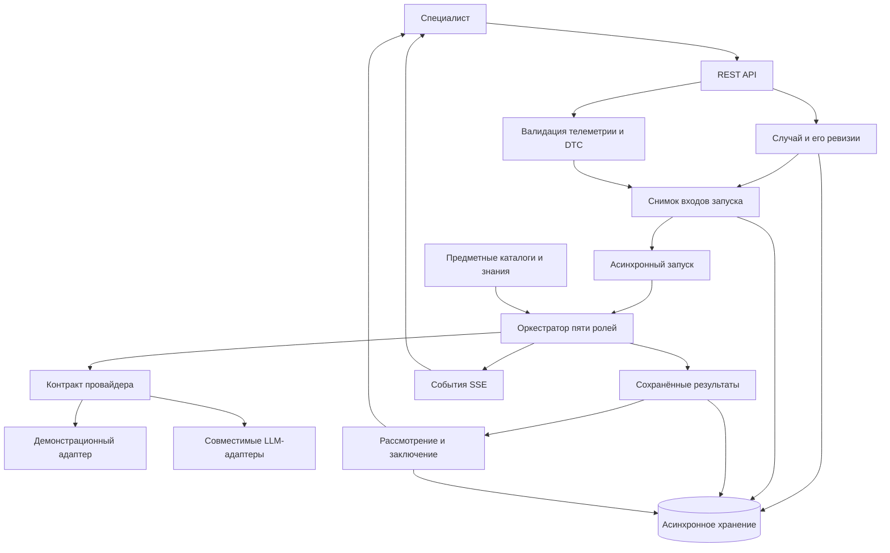

# Архитектура MANF-DiagnoCAR

Этот документ описывает приватную реализацию. Публичная витрина не содержит серверный код, схемы, конфигурацию провайдеров или предметные материалы. Названия модулей приведены для знакомства с устройством проекта; они не являются ссылками на публичные исходники.

## Контур обработки

Адреса сервисов, содержимое каталогов, данные диагностических случаев и результаты рабочих запусков в диаграмму не включены.

## Пять ролей

| Роль | Задача | Граница ответственности |
|---|---|---|
| Приём данных | Подготовить наблюдения и статистики телеметрии, извлечь DTC | Пропуск сохраняется как пропуск; наблюдение не превращается в диагноз |
| Знания | Найти применимые сведения с учётом профиля автомобиля | Результат зависит от доступных и совместимых предметных материалов |
| Гипотезы | Сформировать возможные объяснения с основаниями и ограничениями | Семантическая часть выполняется через выбранного провайдера |
| Проверка гипотез | Проверить основания и противоречия | Проверка предположения не равна подтверждению физической неисправности |
| Рекомендации | Предложить инструментальные проверки для специалиста | Заключение остаётся предметом профессионального рассмотрения |

## Основные слои

| Слой приватной реализации | Назначение |
|---|---|
| `backend/app/api/v1/` | API случаев, данных, знаний, моделей, запусков и заключений |
| `backend/app/services/` | Жизненный цикл сущностей, запусков и результатов |
| `backend/app/agents/` | Последовательность диагностических ролей |
| `backend/app/providers/` | Контракт и адаптеры провайдеров |
| `backend/app/catalogs/` | Загрузка предметных каталогов |
| `backend/app/schemas/` | Проверка входов и контракты обмена |
| `backend/app/db/` | Асинхронное хранение и ORM-модели |
| `backend/evaluation/` | Инструменты сравнительной оценки при наличии разрешённых входов |

## Почему границы разделены

Ревизии и снимки связывают результат с определённой версией входов. Асинхронный запуск позволяет наблюдать стадии через SSE. Идемпотентные операции и контроль ревизий ограничивают повторную обработку и конфликтующие изменения. Контракт провайдера позволяет отделить организацию процесса от конкретной модели.

Детерминированные проверки входов не служат доказательством качества семантических этапов. Демонстрационный адаптер, реальный провайдер и предметные каталоги требуют отдельной оценки в разрешённом контуре.

## Публичный пример

[`examples/main.py`](../examples/main.py) — новый самостоятельный пример на стандартной библиотеке Python. Он обрабатывает синтетический ряд и печатает описание стадий. В нём нет производственных контрактов, запросов к модели, диагностических гипотез или данных рабочего контура.

[К описанию проекта](../README.md) · [К дереву приватной реализации](SOURCE_TREE.md)
